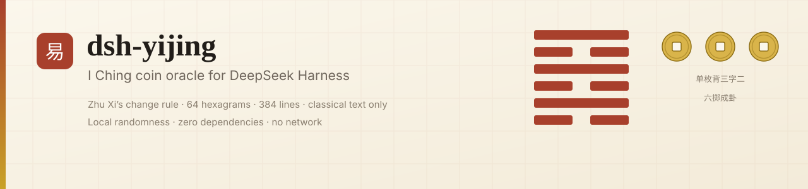
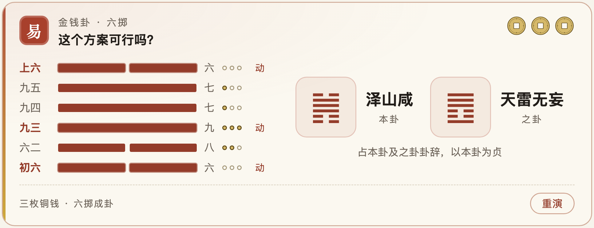
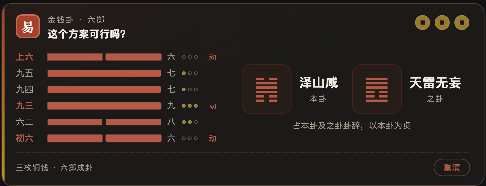
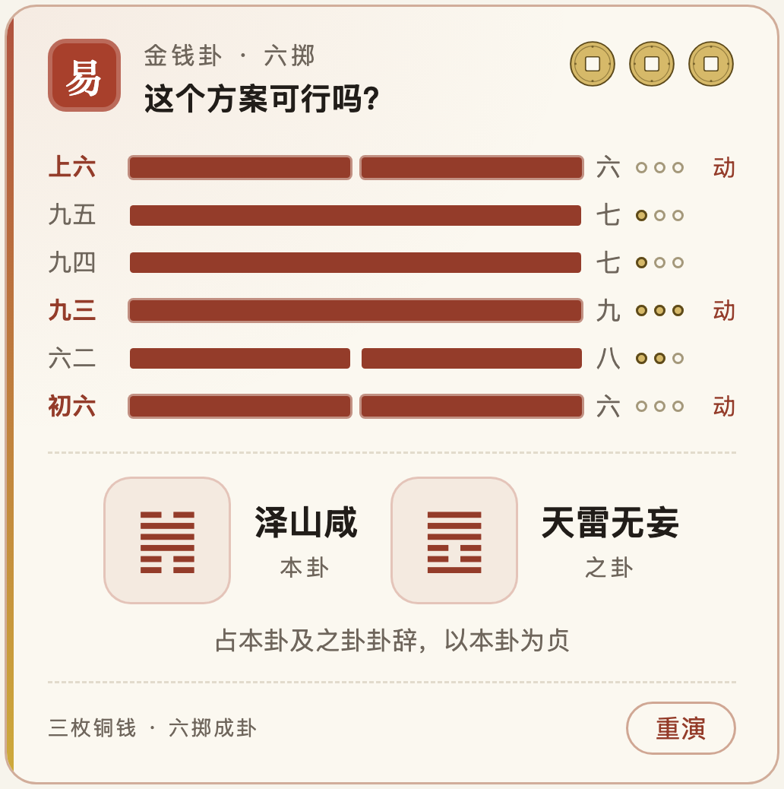

<div align="center">



# dsh-yijing

**Cast the I Ching inside DeepSeek Harness — three coins, six lines, and the classical Zhouyi text. No vernacular, no network, no dependencies.**

[](https://github.com/Kochere/dsh-yijing)
[](LICENSE)
[](test)
[](package.json)
[](package.json)
[](#privacy)

[Quick start](#quick-start) · [Why this one](#why-this-one) · [How it works](#how-it-works) · [Text & sources](#text--sources) · [中文](README.zh-CN.md)

</div>

<p align="center"><br><sub>The cast card: three coins, six lines, 本卦 → 之卦.</sub></p>

A divination is not a generic tool call. The agent casts six coin lines, the chat shows a **three-coin cast card** that draws the hexagram from the bottom up, and then the agent reads the returned classical text — quote first, plain-language explanation after.

## Why this one

- **Classical text only.** The tool returns 卦辞、彖、大象、爻辞、小象、用九/用六 and the 乾/坤 文言, byte-for-byte from the Zhouyi. It never injects a modern translation or commentary. The agent interprets; the plugin does not pretend to.
- **The rule, not a vibe.** 0–6 moving lines are mapped by Zhu Xi’s 《易学启蒙·考变占》 — the exact ruling text for each case, including 乾 用九 / 坤 用六. No “pick a line that sounds nice”.
- **Text you can audit.** 64 hexagrams, 384 lines, 用九/用六 and 文言. Line texts were checked against the 1715 武英殿 edition of 《御纂周易折中》; 58 corrections and 2 documented variants are listed in [docs/SOURCES.md](docs/SOURCES.md).
- **A divination you can see.** A client plugin renders an animated card at the top of the answer, before the reading: three coins flip, six lines draw bottom-to-top, 本卦 → 之卦 settles. It replays when it first scrolls into view, is theme- and reduced-motion-aware, and has a replay button.
- **Local and quiet.** `node:crypto` randomness, no network calls, no telemetry, no runtime dependencies. The question stays in your session.
- **Batteries included.** Two model-facing tools, a CLI for replaying a cast, and 27 tests over data, casting, change rules and the UI.

## Quick start

**Requirements:** DeepSeek Harness (Desktop or `dsh` CLI) with a profile; Node 20+ (bundled with DSH).

```bash
git clone https://github.com/Kochere/dsh-yijing.git
```

1. Open DSH → **Plugins** → **Add plugin** → select the cloned `dsh-yijing` directory.
2. Enable the **易占 · 金钱卦 / I Ching coin oracle** row.
3. Start a new session (or refresh the page) and ask a question.

Agents can install it as a bundle too: call `plugin_manager` `install_bundle` with the absolute package directory.

## Use

Just ask:

> 这个方案可行吗？
>
> Is this plan viable?

The agent should confirm the concrete question if it is vague, then call `yijing_cast` with it verbatim. The card appears; the answer comes back as **古文 + 白话** — the exact classical passage, then what it means for the question.

### Tools

| Tool | What it returns |
|---|---|
| `yijing_cast` | Six coin lines → 本卦、之卦、动爻 → the ruling 卦辞/爻辞 selected by the 变占 rule, plus 互卦/错卦/综卦. Classical text only. |
| `yijing_hexagram` | One hexagram by number, name, symbol or six-bit code: 卦辞、彖、大象、爻辞, with 小象 and 文言 at `detail: "full"`. |

### CLI

```bash
node bin/yijing.mjs cast "此次合作能否谈成？"
node bin/yijing.mjs cast --values 7,8,9,6,7,8 "replay a fixed cast"
node bin/yijing.mjs hexagram 31 --full
node bin/yijing.mjs cast "问事" --json
```

`--values` takes six values (6/7/8/9) from bottom to top and is for replay/testing, not for regular divination.

## How it works

### 1. The coin method

Three coins; 背 = 3, 字 = 2. Six independent tosses from bottom to top: 6 老阴, 7 少阳, 8 少阴, 9 老阳, with probabilities 1/8, 3/8, 3/8, 1/8. Old yin and old yang are moving lines.

### 2. Primary and changed hexagrams

The six lines give 本卦; flipping moving lines gives 之卦. The card and the tool both show 本卦 → 之卦.

### 3. The ruling text

Zhu Xi’s rule, by the number of moving lines:

| Moving lines | Ruling text |
|---|---|
| 0 | 本卦卦辞 |
| 1 | 本卦 moving-line 爻辞 |
| 2 | both 本卦 moving-line 爻辞; the upper one leads |
| 3 | 本卦 and 之卦 卦辞; 本卦 is 贞 |
| 4 | 之卦’s two static-line 爻辞; the lower one leads |
| 5 | 之卦’s static-line 爻辞 |
| 6 | 乾 用九 / 坤 用六; otherwise 之卦 卦辞 |

“彖辞” here means the text under the hexagram — the 卦辞 — not the 《彖传》. For three moving lines, Zhu Xi also distinguishes 前十卦主贞 / 后十卦主悔; the plugin follows the simpler 本卦为主 reading and says so in the result.

### 4. The answer

The plugin stops at the text. The model reads 卦象 (上下卦、爻位、时义、互错综), quotes the classical passage, and explains it in the user’s language. A divination is a reading of the situation, not a prediction of fact.

## Text & sources

- 64 hexagrams, 384 lines, 用九/用六, 乾/坤 文言; only classical text, no vernacular fields in the data.
- Base text: [Classical-Chinese-Text-Dataset](https://github.com/wangxb96/Classical-Chinese-Text-Dataset) (simplified, punctuated).
- Line audit: [《御纂周易折中》武英殿刊本 (1715) transcription](https://zenodo.org/records/23298982), including 384 lines and 用九/用六.
- Cross-check: [open-iching](https://github.com/john-walks-slow/open-iching) 彖/象/文言.
- 58 asserted corrections (e.g. 大有六二 was the 同人 line; 姤九五 was duplicated; 复初九 “不复远” → “不远复”; 震大象 “虩雷…修身” → “洊雷…修省”) and 2 documented variants. Every correction asserts its old string at build time.

Full provenance and the correction list: [docs/SOURCES.md](docs/SOURCES.md). Rebuild:

```bash
node scripts/fetch-sources.mjs   # downloads the three transcriptions
node scripts/build-data.mjs      # writes lib/hexagrams.json, prints the audit
```

The vendored raw transcriptions are intentionally not committed; the build fetches them.

## Privacy

- No network at runtime; no analytics, no remote calls. The only network use in this repo is the optional data-build script.
- Randomness comes from `node:crypto` on your machine.
- The question is part of the session, like any other message. The plugin does not store it elsewhere.
- The interpretation is produced by your model; the plugin never ships a vernacular “answer key”.

## Screenshots

| Theme |
|---|
| **Light**<br> |
| **Dark**<br> |
| **Compact**<br> |

The card comes from a `yijing` fence in the answer (the tool result supplies it), so it sits before the reading. It only appears for Turns that contain a `yijing_cast`; there is no second card at the end.

## Project layout

```
index.js            Host plugin: yijing_cast / yijing_hexagram
client.js           Client plugin: animated cast card
lib/hexagrams.json  Generated Zhouyi text (64/384 + 文言)
lib/cast.js         Coin method and hexagram derivation
lib/rules.js        Zhu Xi’s change-divination rule
bin/yijing.mjs      CLI
scripts/            data build, source fetch, preview generators
test/               27 tests: data, casting, rules, UI
docs/               detail page, sources, artwork
```

## Roadmap

- [ ] English labels in the cast card (i18n via `ctx.locale`)
- [ ] Publish to npm and a one-command install
- [ ] Optional 六爻 (纳甲) mode — explicitly out of scope today
- [ ] More preview assets and a short demo video

## Contributing

Issues and PRs are welcome. Run the suite before opening a PR:

```bash
node --test "test/*.test.mjs"
```

See [CONTRIBUTING.md](CONTRIBUTING.md) for data rebuilds, client previews and the PR checklist.

## License

Code: [MIT](LICENSE). The Zhouyi classical text is public domain; transcription provenance and attribution are in [docs/SOURCES.md](docs/SOURCES.md).

<div align="center">

**If this makes a divination legible to you, a ⭐ helps others find it.**

</div>
