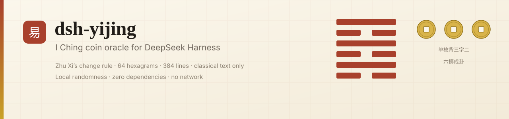
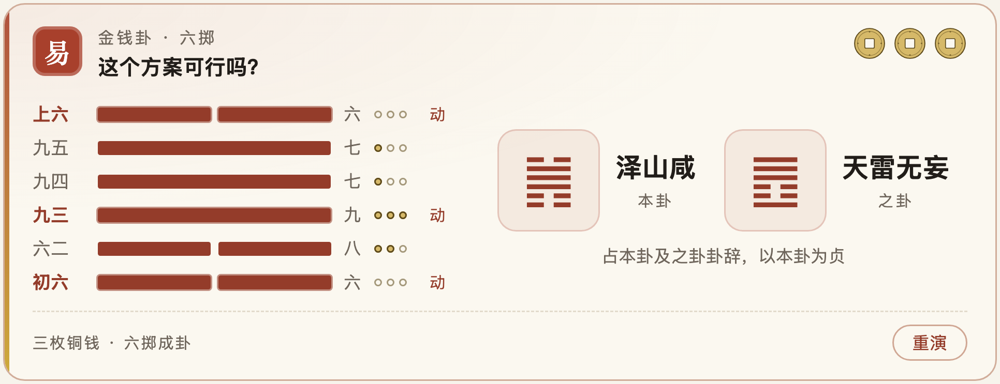
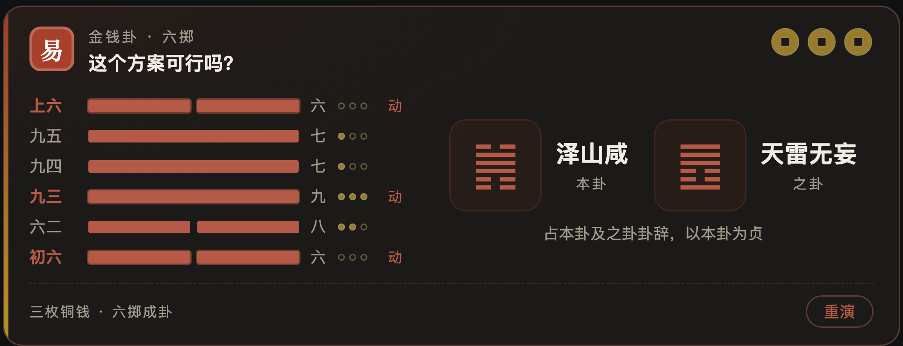
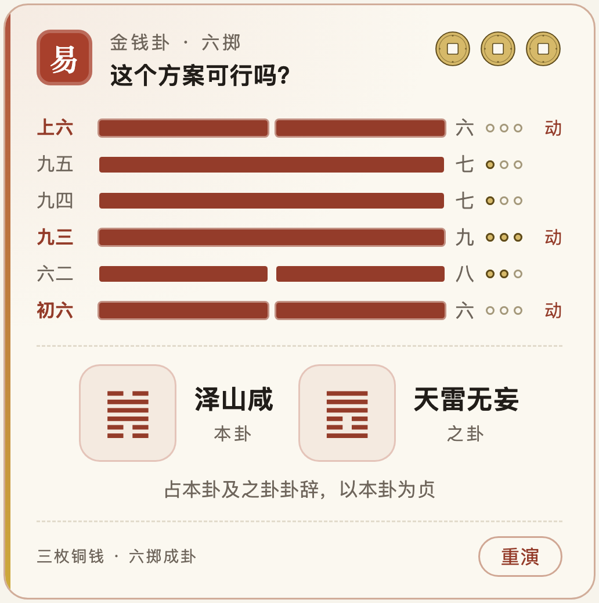

<div align="center">



# 易占 · 金钱卦（dsh-yijing）

**在 DeepSeek Harness 里摇一卦：三枚铜钱、六爻成卦，只取《周易》古文。无白话译文、无网络请求、零运行时依赖。**

[](https://github.com/Kochere/dsh-yijing)
[](LICENSE)
[](test)
[](package.json)
[](package.json)
[](#隐私)

[快速开始](#快速开始) · [为什么是它](#为什么是它) · [怎么算](#怎么算) · [经文与校勘](#经文与校勘) · [English](README.md)

</div>

<p align="center"><br><sub>起卦卡：三枚铜钱、六爻成卦，本卦 → 之卦。</sub></p>

卜卦不再是一次普通的工具调用：智能体摇出六爻，聊天里出现一张**三枚铜钱起卦卡**，六爻自下而上画出，随后落本卦、之卦；解卦由模型完成——**先引古文，再用白话讲清**。

## 为什么是它

- **只给古文。** 工具返回卦辞、彖、大象、爻辞、小象、用九用六、乾坤文言，逐字取自《周易》；不塞白话翻译，不冒充注疏。解卦是模型的事，插件不替它编。
- **有法可依。** 0–6 个动爻按朱子《易学启蒙·考变占》取辞，乾用九、坤用六也照办；不是“挑一句顺眼的”。
- **经文可查。** 64 卦、384 爻、用九用六、乾坤文言俱全；爻辞逐条与《御纂周易折中》武英殿刊本（1715）对校，**58 处订正、2 处存异**，全在 [docs/SOURCES.md](docs/SOURCES.md)。
- **看得见的卜卦。** Client 插件把动画卦卡放在回答开头（解卦之前）：铜钱翻转、六爻自下而上、本卦 → 之卦；进入视野时自动重播一次，随明暗主题、尊重“减少动态效果”、可手动重播。
- **本地、安静。** `node:crypto` 取随机数；无网络、无遥测、零运行时依赖；所问只在会话里。
- **开箱可用。** 两个工具、一个可复核的 CLI、27 项测试（数据、起卦、取辞、UI）。

## 快速开始

**要求**：DeepSeek Harness（Desktop 或 `dsh` CLI）与一个 profile；Node 20+（DSH 自带）。

```bash
git clone https://github.com/Kochere/dsh-yijing.git
```

1. 打开 DSH → **插件** → **添加插件** → 选中克隆下来的 `dsh-yijing` 目录；
2. 启用 **易占 · 金钱卦** 这一行；
3. 新开一个会话（或刷新页面），直接问。

智能体也可以用 `plugin_manager` 的 `install_bundle`，传入包的绝对路径。

## 使用

直接问：

> 这个方案可行吗？

问题含糊时，智能体会先确认一句；确认后原样交给 `yijing_cast`。卦卡出现，回答按**古文 + 白话**给出：先引原句，再讲这句落在所问上是什么意思。

### 工具

| 工具 | 返回 |
|---|---|
| `yijing_cast` | 六爻 → 本卦、之卦、动爻 → 按变占法取出的卦辞/爻辞，附互卦、错卦、综卦。只有古文。 |
| `yijing_hexagram` | 按序号、卦名、卦符或六位阴阳码查一卦：卦辞、彖、大象、爻辞；`detail: "full"` 加小象、用九用六、乾坤文言。 |

### 命令行

```bash
node bin/yijing.mjs cast "此次合作能否谈成？"
node bin/yijing.mjs cast --values 7,8,9,6,7,8 "复核一卦"
node bin/yijing.mjs hexagram 31 --full
node bin/yijing.mjs cast "问事" --json
```

`--values` 六个数自初爻至上爻，取 6/7/8/9，用于复核与测试；正式占问不必指定。

## 怎么算

### 1. 金钱法

三枚铜钱，单枚背三字二；六掷，自初爻至上爻。六老阴、七少阳、八少阴、九老阳，概率 1/8、3/8、3/8、1/8；老阴老阳为动。

### 2. 本卦与变卦

六爻成本卦，动爻翻转成之卦。卦卡与工具都显示 本卦 → 之卦。

### 3. 取辞

朱子《易学启蒙·考变占》，按动爻数取辞：

| 动爻 | 所主 |
|---|---|
| 0 | 本卦卦辞 |
| 1 | 本卦动爻爻辞 |
| 2 | 本卦两动爻爻辞，以上爻为主 |
| 3 | 本卦及之卦卦辞，以本卦为贞 |
| 4 | 之卦两静爻爻辞，以下爻为主 |
| 5 | 之卦静爻爻辞 |
| 6 | 乾用九、坤用六；余卦用之卦卦辞 |

朱子所谓“彖辞”是卦下之辞，即卦辞，不是《彖传》。三爻变又有“前十卦主贞、后十卦主悔”的细分；本插件从简，以本卦为主，并在结果里注明。

### 4. 解卦

插件到经文为止；模型读卦象（上下卦、爻位、时义、互错综），引原句，用用户的语言解释。占断是对处境的读解，不是对事实的预言。

## 经文与校勘

- 64 卦、384 爻、用九用六、乾坤文言；数据里没有任何白话字段。
- 底本：[Classical-Chinese-Text-Dataset](https://github.com/wangxb96/Classical-Chinese-Text-Dataset)（简体标点）。
- 爻辞校勘：[《御纂周易折中》武英殿刊本（1715）转录](https://zenodo.org/records/23298982)。
- 彖/象/文言对照：[open-iching](https://github.com/john-walks-slow/open-iching)。
- **58 处订正**（如大有六二误成同人爻辞、姤九五整句重复、复初九“不复远”正为“不远复”、震大象“虩雷…修身”正为“洊雷…修省”），2 处存异（革六二“己日/已日”、中孚初九“有它/有他”）。每条订正都断言旧文，构建时对不上会直接报错。

重建：

```bash
node scripts/fetch-sources.mjs   # 取三份转录
node scripts/build-data.mjs      # 生成 lib/hexagrams.json 并打印审计
```

原始转录不随仓库提交，构建时按 URL 获取。

## 隐私

- 运行时不联网、不统计、不远程调用；仓库里唯一用到网络的是可选的数据构建脚本。
- 随机数由本机 `node:crypto` 产生。
- 所问只属于会话，插件不另存。
- 解卦由你的模型生成；插件不附带“标准答案”。

## 截图

| 主题 |
|---|
| **明色**<br> |
| **暗色**<br> |
| **窄屏**<br> |

卦卡由回答里的 `yijing` 代码块渲染（工具结果已带好），所以位于解卦之前；末尾不再重复出现。只在含 `yijing_cast` 的回合出现。

## 目录

```
index.js            Host：yijing_cast / yijing_hexagram
client.js           Client：动画卦卡
lib/hexagrams.json  生成的经文（64/384 + 文言）
lib/cast.js         金钱法与成卦
lib/rules.js        朱子变占取辞
bin/yijing.mjs      CLI
scripts/            数据构建、来源下载、预览生成
test/               27 项测试
docs/               详情页、来源、图
```

## 路线

- [ ] 卦卡英文标签（接 `ctx.locale`）
- [ ] 发布 npm，一条命令安装
- [ ] 六爻纳甲模式（目前明确不做）
- [ ] 更多预览资产与短视频

## 参与

欢迎 issue 与 PR。提交前跑：

```bash
node --test "test/*.test.mjs"
```

数据重建、客户端预览与 PR 清单见 [CONTRIBUTING.md](CONTRIBUTING.md)。

## 许可

代码：[MIT](LICENSE)。《周易》经文属公有领域；转录来源与署名见 [docs/SOURCES.md](docs/SOURCES.md)。

<div align="center">

**如果它让你第一次看清一卦是怎么来的，点个 ⭐ 让更多人找到它。**

</div>
